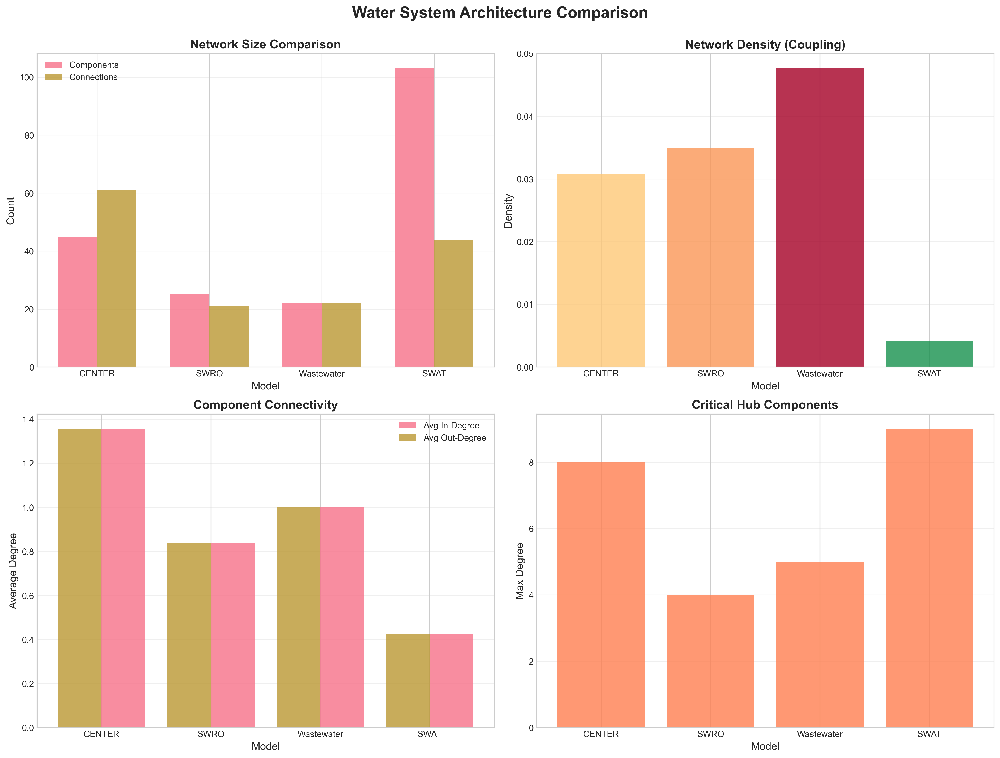

# Structural comparison of four water system architectures

This dissertation research summary compares directed component dependency graphs extracted from four Vensim water and wastewater models. Nodes represent components identified by the analysis rules. Directed edges represent modeled dependencies between those components.

## Architecture comparison

| Architecture | Components | Directed connections | Density | Mean in-degree | Mean out-degree | Maximum total degree |
|---|---:|---:|---:|---:|---:|---:|
| CENTER | 45 | 61 | 3.08% | 1.36 | 1.36 | 8 |
| SWRO | 25 | 21 | 3.50% | 0.84 | 0.84 | 4 |
| Wastewater | 22 | 22 | 4.76% | 1.00 | 1.00 | 5 |
| SWAT | 103 | 44 | 0.42% | 0.43 | 0.43 | 9 |

[Download the comparison data](model_comparison.csv). The CSV expresses density as a fraction.

## Findings

- **CENTER had the most directed connections** and the highest mean in-degree and out-degree across the four extracted graphs.
- **Wastewater had the highest density** despite having the fewest components. Density measures the share of possible directed connections represented in the graph.
- **SWAT had the most components, the lowest density, and the highest maximum total degree.** A sparse graph can still contain a component with more connections than any component in the other graphs.

The metrics describe the extracted graphs at the chosen modeling granularity. Comparing service continuity or recovery would require separate scenario evidence.

## Availability

The comparison table and figure summarize the dissertation analysis. The source Vensim models and simulation datasets are private. Reproducing the original extraction requires access to the source models.
